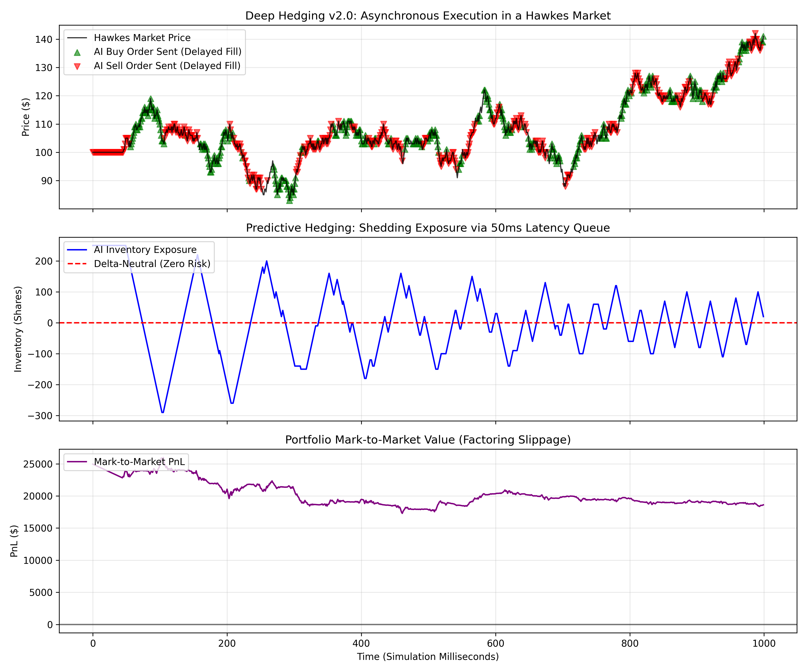
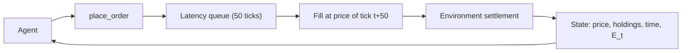
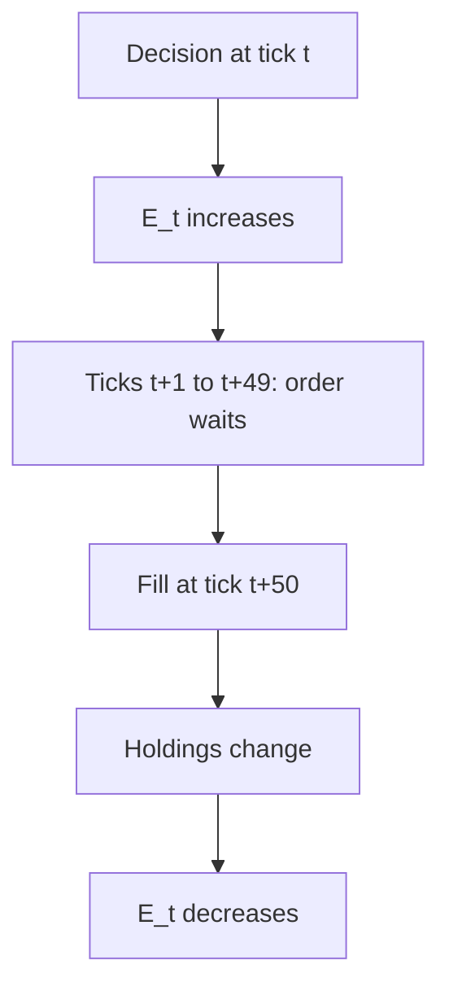
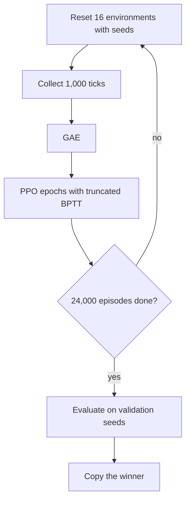

# Asynchronous Actor-Critic Architectures for Delta-Neutral Hedging

Optimizing Execution under Hawkes Volatility and Microstructural Latency.

Integrated Dual Degree (B.Tech. + M.Tech.) Thesis, Department of Mathematical Sciences, IIT (BHU) Varanasi.
Anish Dixit, Roll No. 21124056, 2026. Supervisor: Prof. L.P. Singh.

## 1. What the project does

This project trains a reinforcement-learning agent to control share inventory when orders fill after a delay.
A C++ market simulator creates the price path with a Hawkes process. Each order fills 50 ticks after the decision.
The agent starts with a random inventory and must bring it into a band of ±30 shares.
The model contains no option. "Delta-neutral" here means zero share inventory only.

### Background

Hawkes process: a large event raises the probability of more events. This effect creates volatility clusters.
A model with independent price increments does not show this effect.
Latency problem: the agent sends an order, but the order is not in the inventory for 50 ticks.
During this time the agent can send the same order again.
The agent sees the current price and inventory. Only the execution is delayed. The task is an MDP with delayed actions.
Two quantities are hidden: the fill time of each pending order, and the Hawkes excitation level.
The in-flight exposure (E_t) gives only the total of the pending orders.

Terms used in this file:

- Implementation shortfall: final mark-to-market value minus initial mark-to-market value.
- In-flight exposure (E_t): the total size of the orders that are sent but not yet filled.
- Core: one independent training run with its own seed.

The 10 cores train 10 independent agents. They do not share weights, gradients or data.
"Asynchronous" refers to the market execution with 50-tick latency. It does not refer to A3C-style workers.

## 2. Requirements

- Python 3.13.
- A C++17 compiler. g++ 13.3 was verified. MSVC on Windows was not tested.
- Packages as in `requirements.txt`:

| Package | Version |
|---|---|
| torch | 2.14.1 |
| numpy | 2.5.3 |
| matplotlib | 3.11.2 |
| pybind11 | 3.1.0 |
| setuptools | 84.0.0 |
| pytest | 9.1.1 |

These versions were verified on 2026-10-17 in a Linux cloud environment.
The versions of the thesis run were not recorded.

## 3. Setup

1. Clone the repository: `git clone https://github.com/AnishDikxit/async-deep-hedging.git`
2. Go to the folder: `cd async-deep-hedging`
3. Create a virtual environment: `python -m venv venv`
4. Activate it: `source venv/bin/activate` (Windows: `venv\Scripts\activate`)
5. Install the packages: `pip install -r requirements.txt`
6. Go to the Python folder: `cd python`
7. Build the C++ module: `python setup.py build_ext --inplace`
8. Return to the root folder: `cd ..`
9. Run the tests: `python -m pytest`

Expected result of step 9: `9 passed`.
The build creates a `cpp_exchange` module file in `python/`. The repository contains no compiled file.

## 4. Run

Run all commands from the `python/` folder.

### Train

```bash
python train_multicore.py --run-name main
```

Options: `--arch lstm|mlp`, `--no-in-flight`, `--base-seed N`, `--cores N`, `--episodes N`, `--entropy-coef X`, `--no-cost-shaping`, `--penalty-shaping`, `--core-ids K ...`, `--select-winner`.
Expected output:

```
Launching 10 independent PPO-LSTM runs (one for each core)...
[Core 0] Episode 0048 | Shortfall: $<value> | critic/actor loss: <value>
Core 0 (seed 0) Train Avg Shortfall (Last 100 Eps): $<value> | Validation objective: <value>
[*] WINNER: Core <k> (Score: $<value>)
Saved deep_hedging_weights.pth and runs/main/winner.json
```

A smoke test takes about 15 s in the cloud environment:

```bash
python train_multicore.py --run-name smoke --cores 1 --episodes 48
```

### Ablation

The ablation has four configurations and five seeds for each configuration.
The configurations are LSTM or MLP, each with or without E_t. For example:

```bash
python train_multicore.py --run-name lstm_inflight_s0 --arch lstm --base-seed 0
python train_multicore.py --run-name mlp_noinflight_s0 --arch mlp --no-in-flight --base-seed 0
```

Each run writes `deep_hedging_weights.pth`. You must evaluate each run before the next run starts, or copy the file.

### Evaluate

```bash
python evaluate.py --policies agent rule twap
```

The command uses all 1,000 test seeds (seeds 0-999). Expected output:

```
policy    mean IS     std IS   CVaR5 IS  RMS inv   %out   fills
...
Saved results/eval_summary.json
```

The next command needs no checkpoint and takes about 3 s:

```bash
python evaluate.py --policies rule twap --num-seeds 20
```

### One-episode figure

```bash
python test.py
```

The script prints the implementation shortfall and the legacy mark-to-market PnL.
It also prints the orders sent, the fills, the spread and fees, and the band penalty. It saves `thesis_v2_asynchronous_evaluation.png`.

### Volatility figure

```bash
python generate_plot.py
```

The script saves `volatility_comparison.png`.

## 5. Project layout

```
async-deep-hedging/
├── src/exchange.cpp        # C++ simulator: Hawkes process, 50-tick latency queue
├── python/
│   ├── config.py           # all hyperparameters (single source)
│   ├── environment.py      # environment, reward, implementation shortfall
│   ├── agent.py            # network and PPO agent
│   ├── train_multicore.py  # training, one independent run for each core
│   ├── evaluate.py         # agent, rule and TWAP on fixed test seeds
│   ├── test.py             # one-episode evaluation and figure
│   ├── generate_plot.py    # volatility figure
│   └── setup.py            # build script for the C++ module
├── tests/                  # pytest tests
├── legacy/                 # old v1 files, not runnable
├── assets/                 # figures
├── docs/AUDIT_REPORT_v2.md # audit of the thesis code
├── requirements.txt
└── CORRECTIONS_LOG.md
```

## 6. Results

### Simulator rules

- Agent orders do not enter the order book. Each order is a market order. The price argument is ignored.
- Each order fills completely at the price 50 ticks later, plus or minus $0.50, plus a $1 fee.
- The order size is fixed at 10 shares. The start cash is $10,000 and the start price is $100.
- The simulator has no market impact, no liquidity limit and no variable spread.
- Reward: R_t = ΔMTM_t − 0.001 · max(0, |I_t| − 30)². The penalty is part of the reward only.
- Hawkes intensity for each tick: x_t = 0.98 · x_(t−1), then λ_t = min(1, 0.02 + x_t).
  An event occurs with probability λ_t. Each event adds alpha_jump to x_t.
- The thesis code used alpha_jump 0.15. This gives a branching ratio of 7.35 and an unstable process.
  The audit report gives 7.5.
- The default is now alpha_jump 0.012. The branching ratio is 0.588. The stable event rate is 0.0485 per tick.
  `tests/test_exchange.py` checks these values.

### Legacy results (thesis code)

All figures in `assets/` came from the thesis code. The current code has different defaults.
The figures are legacy results. The existing checkpoints do not load into the new network, because it has an MLP encoder.



Fig. 4.3 (`assets/thesis_v2_asynchronous_evaluation.png`) shows a decaying limit cycle in one episode.
The agent sends orders on most ticks. Inventory oscillates with overshoots of about ±100 to ±300 shares.
These overshoots continue to the end of the episode.

| Number | Value | Source |
|---|---|---|
| Value at the end of the PnL curve | near $19,000. This is mark-to-market value minus starting cash. It includes the initial inventory value (+250 shares × $100 = $25,000 at t = 0) and the band penalty. | `assets/thesis_v2_asynchronous_evaluation.png` |
| Implementation shortfall | approximately −$6,400 | audit estimate from the figure, `docs/AUDIT_REPORT_v2.md`, finding C1; not measured again |
| Trades and cost | about 900 trades, about $5,400 | audit estimate from the figure, `docs/AUDIT_REPORT_v2.md`, finding C5; not measured again |

Fig. 4.3 is one episode with no baseline.
No ablation separates the effect of E_t from the effect of the LSTM. The data does not show that the LSTM is necessary.

### New metrics

Results: pending a local run. The checkpoints exist only on the author's local machine.
`evaluate.py` runs 1,000 fixed test seeds (seeds 0-999) against a rule baseline and a TWAP baseline.
Output files:

| File | Content |
|---|---|
| `python/results/eval_summary.json` | summary of each policy |
| `python/results/eval_<policy>.csv` | one row for each test seed |
| `python/runs/<run_name>/config.json` | configuration of the run |
| `python/runs/<run_name>/winner.json` | winning core and validation scores |

### Hyperparameters

`python/config.py` is the single source. Each training run saves its values in `config.json`.

| Parameter | config.py default | Value in the thesis code (Fig. 4.3) |
|---|---|---|
| alpha_jump | 0.012 | 0.15 |
| Initial inventory I0 | U(-500, 500), integers | {-500, -250, 250, 500} |
| Learning rate | 1e-4 | 1e-4 |
| Discount gamma | 0.999 | 0.99 |
| GAE lambda | 0.95 | 0.95 |
| Clip | 0.2 | 0.2 |
| PPO epochs | 10 | 4 |
| Entropy coefficient | 0.01 | 0.05 |
| Value coefficient | 0.5 | 0.5 |
| Max grad norm | 0.5 | 0.5 |
| BPTT | truncated, 64 ticks | full, 1,000 ticks |
| Reward | linear (reward / 1000) | entropic utility on each step (lambda 0.05) |
| Value scaling | running std | none |
| Cost shaping | on: the $6 order cost is charged at the decision tick (potential-based) | none |
| Penalty shaping | off (option: the band penalty of pending orders is charged at the decision tick) | none |
| Environments per core | 16 (4 minibatches) | 1 |
| Network | MLP encoder, LSTM 64, actor and critic heads | LSTM 64, heads (no encoder) |
| Episodes per core | 24,000 | 8,000 |
| Cores | 10 | 10 |
| Latency | 50 ticks | 50 ticks |
| Band and penalty | ±30, 0.001 × excess² (reward only) | same coefficient, but taken from cash |

## 7. Known limits

- The model contains no option. The task is inventory control under execution latency.
  The agent liquidates toward a band of ±30 shares. "Delta-neutral" means zero share inventory only.
- Agent orders have no market impact, no liquidity limit and no variable spread.
- The figures in `assets/` are legacy results from the thesis code. The checkpoints do not load into the current network.
- Fig. 4.3 is one episode with no baseline. No ablation separates E_t from the LSTM.
- No multi-seed result exists yet. It needs the checkpoints from the author's local machine.
- The v1 synchronous system is historical. Its code is in `legacy/` and cannot run. Its results were not kept.
- The software versions of the thesis run were not recorded.
- The audit report lists more open findings: `docs/AUDIT_REPORT_v2.md`.

### Historical figures

These figures cannot be reproduced from this repository.

| File | Caption in the old README | Status |
|---|---|---|
| `assets/baseline_evaluation.png` | untrained agent | code version not recorded, not reproducible |
| `assets/God_Mode_Loop.drawio.png` | v1 zero-latency design | v1 diagram, not reproducible |
| `assets/thesis_quantitative_evaluation.png` | v1 zero-latency evaluation, MTM PnL near $46,000 | v1 result, not reproducible. The value includes the initial inventory value. |
| `assets/v2_architecture.drawio.png` | v2 design | drawn for the thesis design, not the current network |
| `assets/volatility_comparison.png` | volatility comparison | thesis Fig. 2.1, from an illustration model, not the engine |

`python/generate_plot.py` now adds a third panel from the C++ engine.

## 8. Diagrams

### Data flow in one tick



In each tick, the agent can send an order. The order fills 50 ticks later at the price of that tick.

### Delayed-action transition



The decision changes E_t at once, but the order changes the holdings only at tick t+50.

### Training loop of one core



Each core runs this loop alone, and the best core by validation score is copied.

## Citation

```bibtex
@mastersthesis{dixit2026async,
  title      = {Asynchronous Actor-Critic Architectures for Delta-Neutral Hedging:
                Optimizing Execution under Hawkes Volatility and Microstructural Latency},
  author     = {Dixit, Anish},
  school     = {Indian Institute of Technology (Banaras Hindu University), Varanasi},
  year       = {2026},
  type       = {Integrated Dual Degree (B.Tech.+M.Tech.) Thesis},
  department = {Department of Mathematical Sciences}
}
```
